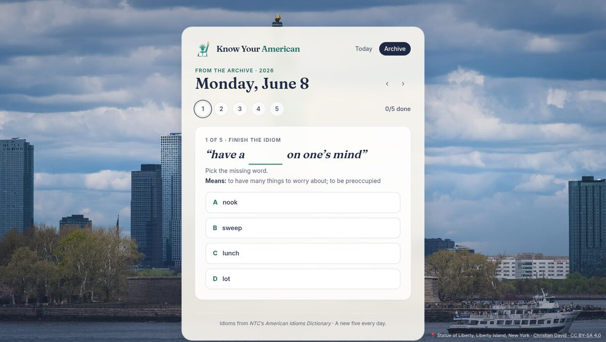
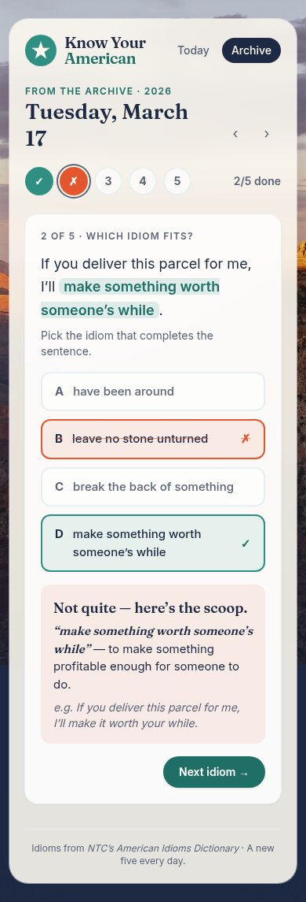
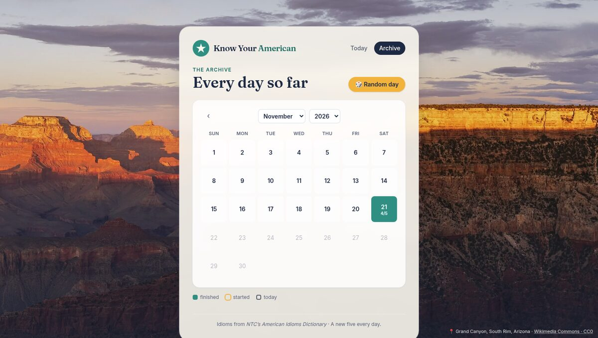

# Know Your American

**Five American idioms a day.** Open the site and today's five are waiting for you. Pick what
*"bite the bullet"* means, finish *"burn the ___ at both ends"*, or spot which idiom completes a
sentence. One tap per idiom. Come back tomorrow for five new ones, or dig through the archive.

Deployed at **https://kya.chol.dev**

<p align="center">
  
</p>
<p align="center">
  
  &nbsp;
  
</p>

---

## How to play

- **Five idioms every day.** "Today" is *your* local date, so everyone gets a fresh set at their own midnight.
- **Three kinds of question**, mixed each day:
  - **What does it mean?** Pick the meaning of the idiom.
  - **Finish the idiom.** A word is missing; pick it. The meaning is shown as a hint.
  - **Which idiom fits?** A sentence from the dictionary with a blank; pick the idiom that completes it.
- **One shot per idiom.** Get it right and the circle turns green ✓. Miss it and the card shakes, the right
  answer is revealed with its meaning and an example, and the circle turns red ✗.
- **The five circles** track your progress ("3/5 done"). Tap a circle to jump to that idiom.
- **After all five** you get your score, a verdict ("Sharp as a tack!"), a shareable 🟩🟥 row, and a review
  of every idiom you saw.
- **The archive** has every day since **January 1, 2026**. Browse by month and year, or hit
  **🎲 Random day**. Finished days show your score on the calendar.
- **No accounts.** Your answers live in your browser (localStorage). Clearing site data resets your history.

---

## How it works

| | |
|---|---|
| **App** | Spring Boot 4.2 on Java 25, compiled to a **GraalVM native binary** (starts in ~0.2s) |
| **Pages** | Server-rendered **Thymeleaf**; interactions are **HTMX** fragments. No SPA, no npm. |
| **Styling** | **Tailwind CSS v4** via the standalone CLI (downloaded automatically) |
| **Data** | Embedded **SQLite** file, migrated by **Flyway** |
| **Puzzles** | Generated ahead of time by a scheduled job, stored, and never changed |
| **State** | The player's answers stay in their browser; the server stores no player data |

- **Where the idioms come from.** They're extracted once from *NTC's American Idioms Dictionary*. The
  extractor (`tools/idiom-extractor`) reads the PDF by font and layout and writes
  `src/main/resources/db/seed/idioms.jsonl`: about 5,870 idioms with meanings, notes, example
  sentences and a "fun score". The app loads that file into SQLite on first start. It never reads the PDF.
- **How a day is made.** `PuzzleGenerator` picks five unused idioms (favouring colourful ones) and builds
  the questions. Every wrong option is chosen so it can't also be right. Generation is deterministic, so a
  given date always gets the same puzzle. That's about three years of unique days before idioms recycle.
- **The daily job.** At startup and then every hour, the app makes sure puzzles exist from 2026-01-01
  through two days ahead of UTC today. That covers every timezone's "today". It's idempotent, so
  restarts and missed runs are harmless.

More detail for contributors (architecture, conventions, gotchas) is in [`CLAUDE.md`](CLAUDE.md).

---

## Developing

### Prerequisites

- **JDK 25.** For native builds, use **GraalVM 25.0.2 or newer** (e.g. `sdk install java 25.0.2-graalce`);
  25.0.1 can't build the binary. The Maven wrapper (`./mvnw`) is included.
- Linux or macOS with `curl`. The Tailwind CLI downloads itself into `.tools/` on first use.
- Optional: `sqlite3` (for `make idioms` / `make puzzle` / `make db-shell`), and ImageMagick + `cwebp`
  (only to regenerate backgrounds).

### Run it

```bash
make dev        # Tailwind --watch + Spring Boot (dev profile) → http://localhost:8080
```

On first start the app creates `./data/kya.db`, loads the idioms and generates every day so far
(about a second). Then:

- **Templates, CSS, JS, images:** just refresh the browser. In dev they're served straight from
  `src/main/resources`, and Tailwind rebuilds the CSS as you edit.
- **Java:** recompile (Ctrl+F9 in IntelliJ, or `./mvnw -q compile -Dtailwind.skip=true` in another
  terminal) and devtools restarts the app.

### Everyday commands

Run `make help` for the full list.

| Command | What it does |
|---|---|
| `make dev` | Run locally with live reload |
| `make test` | All app tests (`./mvnw verify`) |
| `make puzzle` | Print today's stored questions with answers (`DAY=2026-07-04 make puzzle` for any day) |
| `make idioms` | 10 random idioms from the local DB (`N=20 MIN=70 make idioms` for 20 scoring 70+) |
| `make db-shell` | Open the local database in `sqlite3` |
| `make db-reset` | Delete the local DB; the next start rebuilds everything |
| `make native` | Build the native binary → `target/knowyouramerican` |
| `make run-native` | Run the native binary against `./data/kya.db` |
| `make extract` | Re-extract idioms from the PDF (see below) |
| `make test-extractor` | The extractor's golden tests against the real PDF |
| `make backgrounds` | Re-download the background photos and regenerate `backgrounds.json` |

### Tests

`make test` covers the following:
- **Seed:** the idioms load correctly.
- **Generator** (over 400 simulated days):
  - exactly 4 distinct options per question, exactly one of them correct;
  - no repeated idioms;
  - no answer leaks;
  - deterministic output for a given date.
- **Daily job:** it backfills every day and is idempotent.
- **Web layer:** answer flow, one-shot rule, summary, archive, 404s.

> **Native gotcha:** templates read view-model properties through reflection, which GraalVM strips unless
> registered. If you add a type that a template touches, list it in `config/TemplateHints`. Otherwise the
> page works in `make dev` but returns HTTP 500 in the native binary. CI smoke-tests the binary before
> every deploy to catch exactly this.

### Changing things

- **The generator.** Run `make db-reset` afterwards. Stored days are never regenerated, so you won't see
  your change until the local DB is rebuilt.
- **The idiom data.** The source PDF (`docs/idioms.pdf`) is **not in the repo**; it's a copyrighted ebook,
  kept local only. With a copy in place, `make extract` regenerates `idioms.jsonl`. Review the diff before
  committing. In production, the seed loads once (Flyway V3). Ship corrections as a new migration that
  updates rows by headword; never edit an applied migration.
- **Backgrounds.** Add a line (slug, title, location, exact Wikimedia Commons file name) to
  `scripts/fetch-backgrounds.py` and run `make backgrounds`. Only use photos licensed CC0, CC BY or
  CC BY-SA; the on-page caption credits each one.
- **Schema.** Add a new Flyway migration in `src/main/resources/db/migration/`.

### Project layout

```
src/main/java/com/knowyouramerican/
  idiom/        Idiom model, repository, seed migration (V3)
  puzzle/       PuzzleGenerator, PuzzleService (backfill), PuzzleScheduler, PuzzleCalendar
  web/          PlayController, ArchiveController, view models (GameView, CardView, MonthView)
  background/   Background photo catalog
  config/       SQLite data source, clock, native template hints
src/main/resources/
  templates/    index (page shell), play (game/card/summary), archive, error, fragments/
  static/       js/game.js (local date + localStorage), htmx, fonts, img/bg, img/brand
  db/           Flyway migrations + seed/idioms.jsonl
tools/idiom-extractor/   Offline PDF → idioms.jsonl tool (separate Maven module)
scripts/                 tailwind.sh, fetch-backgrounds.py
deploy/                  systemd unit + nginx server block
.github/workflows/       deploy.yml
```

---

## Operating

### Deploying

Every push to `main` deploys automatically (`.github/workflows/deploy.yml`). You can also run it by hand
from the Actions tab with **Run workflow**.

1. **Build:**
   - runs the tests;
   - compiles the native binary (GraalVM Community 25);
   - **starts the binary and requests the main pages**. If anything fails, nothing is deployed.
2. **Deploy** (GitHub environment **`Deployment`**):
   - copies the binary to the server and swaps it in atomically, keeping the previous one as
     `knowyouramerican.prev`;
   - restarts the service and waits for it to answer;
   - on the first deploy only, it adds the nginx site and gets a Let's Encrypt certificate.

### First-time setup

1. **DNS:** an `A` record for `kya.chol.dev` pointing at the server. certbot needs it.
2. **GitHub:** in *Settings → Environments → Deployment*, add these secrets:
   - `SSH_HOST`: server address
   - `SSH_USER`: `root` (the script writes to `/etc` and manages systemd)
   - `SSH_PRIVATE_KEY`: a key authorised for that user
3. **Server:**
   - nginx and certbot installed (with an existing certbot account);
   - port **8090** free;
   - glibc 2.39 or newer (Ubuntu 24.04 or later), because the binary is built on `ubuntu-latest`.
4. Push to `main`.

### What lives on the server

| Path | What |
|---|---|
| `/opt/knowyouramerican/knowyouramerican` | The app (native binary), run by the `kya` system user |
| `/opt/knowyouramerican/knowyouramerican.prev` | The previous binary, for rollback |
| `/opt/knowyouramerican/data/kya.db` | The SQLite database (idioms + generated puzzles). **Survives deploys.** |
| `/opt/knowyouramerican/.env` | Runtime settings, rewritten on each deploy |
| `/etc/systemd/system/knowyouramerican.service` | Service unit (from `deploy/knowyouramerican.service`) |
| `/etc/nginx/sites-available/default` | Contains the `kya.chol.dev` server block |

The app listens on **127.0.0.1:8090** only; nginx is the public face on 80/443.

**Changing the nginx block:** the deploy adds it to `sites-available/default` only if it isn't there yet,
and keeps a `default.bak.<timestamp>` backup. Later edits to `deploy/nginx/kya.chol.dev.conf` are
**not** reapplied, so edit the server copy and run `nginx -t && systemctl reload nginx`.

### Configuration

All settings are environment variables. The deploy writes them to `.env`.

| Variable | Default | Meaning |
|---|---|---|
| `PORT` | `8080` (`8090` in prod) | HTTP port |
| `SERVER_ADDRESS` | all interfaces (`127.0.0.1` in prod) | Bind address |
| `KYA_DB_PATH` | `./data/kya.db` | SQLite file; parent folders are created |
| `KYA_PUZZLES_SCHEDULER_ENABLED` | `true` | Generate puzzles at startup and hourly |
| `SERVER_FORWARD_HEADERS_STRATEGY` | (`native` in prod) | Trust nginx's `X-Forwarded-*` so share links use `https://` |

### Day-to-day commands (on the server)

```bash
systemctl status knowyouramerican            # is it up?
journalctl -u knowyouramerican -f            # live logs ("Generated N puzzle day(s)" appears hourly when needed)
systemctl restart knowyouramerican           # restart (startup also fills in any missing days)
curl -s -o /dev/null -w '%{http_code}\n' http://127.0.0.1:8090/   # health check from the box
```

**Backups.** The database is the only state worth keeping, and it's small. A safe online copy:

```bash
sqlite3 /opt/knowyouramerican/data/kya.db ".backup '/root/kya-$(date +%F).db'"
```

Losing it isn't fatal: on start, the app reloads the idioms and regenerates every day. The generator is
deterministic, so days come back the same as long as the seed and generator code haven't changed since.

**Rolling back a bad deploy.** Either revert the commit and push, or swap back to the previous binary
right away:

```bash
cd /opt/knowyouramerican && cp -p knowyouramerican.prev knowyouramerican.new \
  && mv -f knowyouramerican.new knowyouramerican && systemctl restart knowyouramerican
```

**Inspecting puzzles.** `sqlite3 /opt/knowyouramerican/data/kya.db`:

```sql
SELECT day_date FROM puzzle_day ORDER BY day_date DESC LIMIT 3;            -- newest days
SELECT position, type, prompt FROM question WHERE day_date = '2026-11-21';  -- one day's questions
SELECT count(*) FROM idiom WHERE used_on IS NULL;                           -- idioms not yet used
```

**Re-rolling a future day.** Only do this for a day nobody has played yet; players' saved answers refer
to the stored options. Delete it with foreign keys on, then restart (or wait for the hourly run):

```sql
PRAGMA foreign_keys = ON;
DELETE FROM puzzle_day WHERE day_date = '2026-11-23';   -- its questions go with it
```

### Troubleshooting

| Symptom | Likely cause |
|---|---|
| Deploy fails at "App did not come up" | The step prints the last 50 log lines. Check `.env` and that port 8090 is free. |
| Pages return 500 but `make dev` is fine | A type used in a template is missing from `config/TemplateHints` (native-only). |
| certbot fails on first deploy | DNS for `kya.chol.dev` doesn't point at the server yet. Fix DNS and re-run the workflow. |
| Binary won't start: `GLIBC_2.xx not found` | The server's glibc is older than the build runner's. Upgrade the OS or build on an older runner. |
| A player says "yesterday's puzzle shows as today" | Their device clock or timezone is off. "Today" comes from the browser. |

---

## Credits & licences

- **Idioms:** *NTC's American Idioms Dictionary*, 3rd ed., Richard A. Spears (McGraw-Hill, 2000).
  Definitions and examples are quoted from the book. The book is © McGraw-Hill and licensed for
  personal, non-commercial use; the PDF itself is not distributed with this repo.
- **Photos:** Wikimedia Commons contributors, under CC0, CC BY 2.0 and CC BY-SA 3.0/4.0. Each photo's
  author and licence are in `src/main/resources/backgrounds.json` and credited on the page.
- **Fonts:** [Inter](https://rsms.me/inter/) and [Fraunces](https://fonts.google.com/specimen/Fraunces),
  SIL Open Font License.
- **[htmx](https://htmx.org)** (BSD Zero-Clause).
- **Logo:** original artwork for this project (`docs/brand/`).
